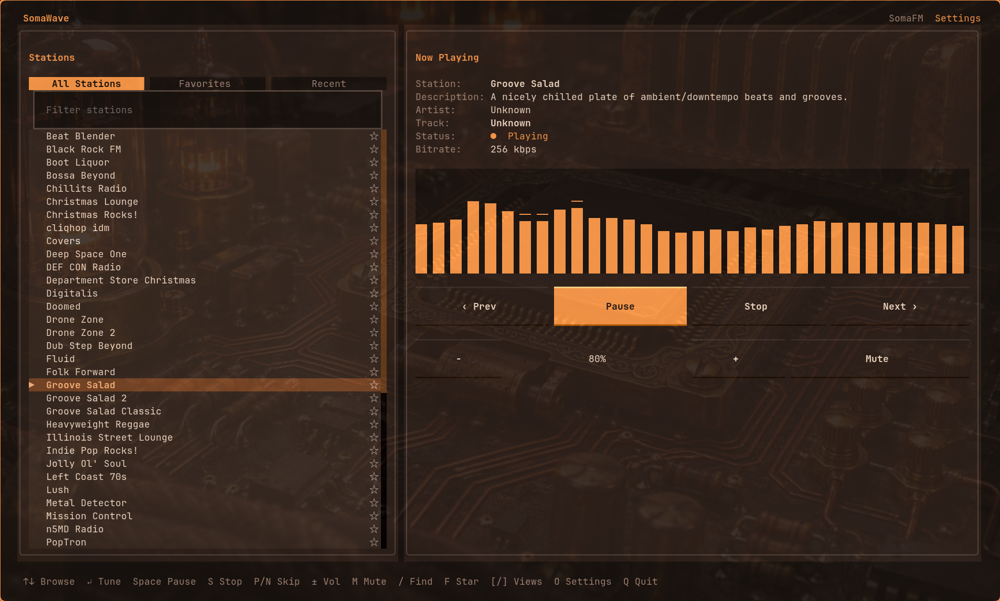
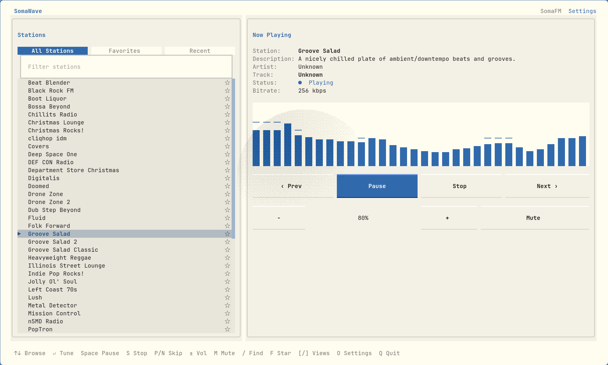
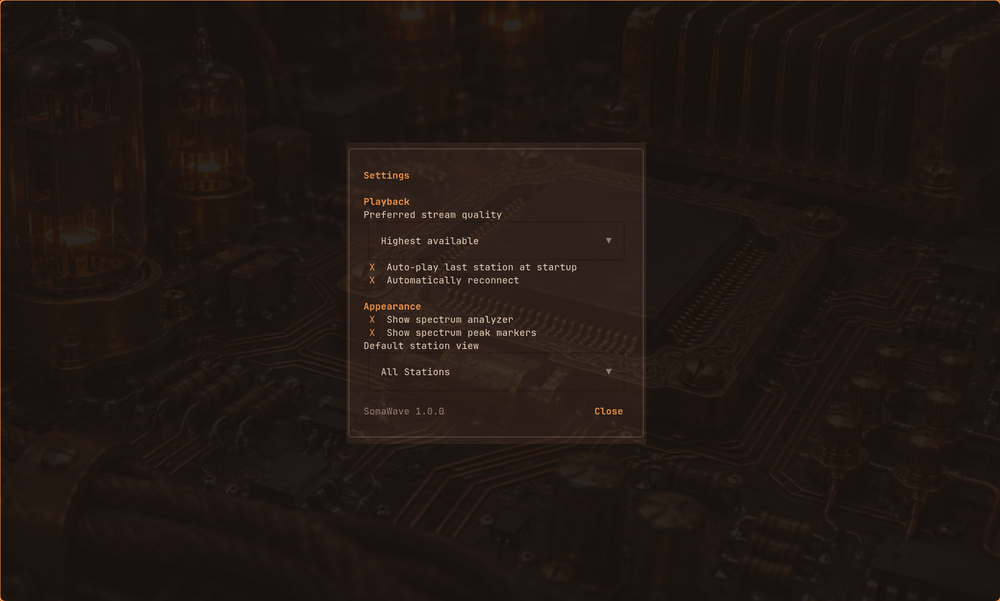

# SomaWave


[](LICENSE)


Independent radio. Terminal style.

SomaWave is an independent, unofficial Linux terminal player for SomaFM.

[](docs/screenshots/dark-theme.png)

## Features

- Browse and filter the live station directory, save favorites, and revisit recently played stations.
- Play streams with MPV and see live track details and an audio spectrum.
- Set a preferred stream quality, automatic reconnection, and startup autoplay. Preferences persist between launches.
- Follow the active Omarchy theme. Other terminal setups use the default SomaWave palette.

## Screenshots

SomaWave follows Omarchy’s active palette, including light themes.

[](docs/screenshots/light-theme.png)

Settings cover stream quality, startup autoplay, reconnection, and spectrum display.

[](docs/screenshots/settings.png)

The Settings screenshot shows v1.0.0. The dialog has the same layout in v1.0.1.

## System requirements

SomaWave was tested on Arch Linux with Omarchy and Foot. Other Linux desktops are expected to work with the dependencies below, but have not been verified.

- Python 3.11 or newer with `venv` and `ensurepip`
- Textual 8.2.8 or newer in the 8.x series, installed in a virtual environment
- MPV with JSON IPC and a working audio output
- A terminal emulator compatible with Textual
- Internet access to SomaFM for live streams and directory updates

## Install and launch

From the extracted Linux archive or a checkout of this repository, run the installer.

```bash
./scripts/install.sh
```

The installer checks for Python and MPV, creates or reuses a dedicated Python virtual environment, and installs Textual and its Python dependencies there. It also installs the original SVG icon and a desktop launcher. Installation runs as your regular user.

Open **SomaWave** from your app menu or run `~/.local/bin/somawave` in your existing terminal. Use `somawave` when `~/.local/bin` is on your PATH.

On Omarchy, the app menu uses Omarchy's native TUI launcher, or its terminal launcher on older installations. Omarchy resolves the default terminal when you open SomaWave. On other desktops, the launcher uses `xdg-terminal-exec` when available or lets the desktop environment choose the terminal.

### Distribution downloads

Release assets will appear on the [v1.0.1 release page](https://github.com/StaleUser0101/SomaWave/releases/tag/v1.0.1) after publication. Download `SomaWave-1.0.1-linux.tar.gz` and `SHA256SUMS` to the same directory. Verify the archive before extracting and installing it.

```bash
sha256sum -c --ignore-missing SHA256SUMS
tar -xzf SomaWave-1.0.1-linux.tar.gz
cd SomaWave-1.0.1
./scripts/install.sh
```

The archive installs without a Git checkout. [All releases](https://github.com/StaleUser0101/SomaWave/releases)

For an existing Python virtual environment, install the downloaded `.whl` with that environment’s `python -m pip install /path/to/wheel.whl` and run `somawave` there. Use the Linux archive for the desktop launcher and icon.

## Native Arch Linux package

Use the native package on a fully up-to-date Arch-based system. In the directory
containing the package and its checksum manifest, run:

```bash
sha256sum -c SHA256SUMS-arch
sudo pacman -U ./somawave-1.0.1-1-any.pkg.tar.zst
/usr/bin/somawave
```

Pacman resolves Bash, GLib, the hicolor icon theme, MPV, Python 3.11 or newer, Rich, and
`python-textual` from 8.2.8 up to (but excluding) 9. The desktop launcher
prefers Omarchy's terminal dispatcher when present, then `xdg-terminal-exec`,
then GLib's terminal selection. The app can also start directly in any
Textual-compatible terminal. After a Python minor-version upgrade, use a native
package rebuilt against that Python version.

Upgrade by verifying and installing the newer package with `pacman -U`. To
remove the app, run `sudo pacman -R somawave`. Upgrades and removal preserve
the XDG settings and cache, including favorites and recently played stations.
See [packaging/arch](packaging/arch/) for building future releases.

### Migrate from the standalone installer

1. Quit SomaWave. Keep the same absolute XDG configuration and cache paths so
   both installations read the same settings and station cache.
2. Install the native package and run `/usr/bin/somawave` to verify your
   preferences. Your existing `~/.local/bin/somawave` can take precedence on
   PATH, and the user-local desktop entry and icon can override the system
   entries.
3. When ready to switch, run `./scripts/uninstall.sh` from the standalone
   release as your regular user, using the same `XDG_DATA_HOME` used during
   standalone installation. It removes the standalone wrapper, desktop
   entry, icon, and dedicated virtual environment while preserving settings
   and cache. Keep the standalone archive if you want to reinstall it later.
   For an independently managed virtual environment, deactivate it when using
   the system command.
4. Open a new shell and run `command -v somawave` to confirm it resolves to
   `/usr/bin/somawave`. Reopen the app menu to pick up the system entry.

## Standalone upgrade and uninstall

Quit SomaWave, extract the new release or check out its source in your repository, and rerun `./scripts/install.sh` with the same XDG environment used for installation. The existing settings and station cache carry over, including favorites and recent history.

Run `./scripts/uninstall.sh` to remove the installed command, desktop launcher, icon, and application virtual environment. Use the same XDG data location as installation. Uninstall preserves preferences, station cache, and the source checkout.

## Controls

| Key | Action |
| --- | --- |
| Up / Down | Browse stations |
| Enter | Tune to the selected station |
| Space | Play or pause |
| S | Stop |
| P / N | Tune to the previous or next station in the current filtered view |
| + / = / − | Increase or decrease volume by five points |
| M | Toggle mute |
| F | Toggle favorite for the selected station |
| [ / ] | Cycle backward or forward through station views |
| / | Focus the filter |
| O | Open Settings |
| Esc | Close Settings or return to the station list |
| Q | Quit |
| Tab / Shift+Tab | Move focus forward or backward between controls |
| Ctrl+C | Copy selected text or show the quit hint in current Textual versions |

Click a station to tune in, or click its star to toggle favorite status while keeping playback going. **All Stations** and **Favorites** are alphabetical. **Recent** shows the last ten unique stations that started playing, most recent first.

The filter searches station names and descriptions in the current view and clears when you change views. Enter or Esc returns focus to the results. Stream and volume controls also support the mouse. In narrow windows, the view buttons use shorter labels, the panels stack, and the player panel scrolls.

## Settings

Press **O** or click **Settings** in the header. Changes save immediately. Press **Esc** or click **Close** to return to the player.

| Setting | Default | Behavior |
| --- | --- | --- |
| Preferred stream quality | Highest available | **Standard** selects the closest advertised rate to 128 kbps. **Low bandwidth** selects the lowest. Applies on the next station tune, with fallback to other official playlists for that station. |
| Auto-play last station at startup | Off | Uses the most recent station that successfully played, with saved volume and mute. If it is unavailable, SomaWave waits for a manual selection. |
| Automatically reconnect | On | Retries unexpected interruptions with delays from one to 30 seconds. Stop, station changes, and quit cancel pending retries. With reconnect off, SomaWave still tries alternate playlists when initially tuning. |
| Show spectrum analyzer | On | Hides the analyzer and removes its MPV filter when turned off. The existing playback session continues. |
| Show spectrum peak markers | On | Toggles peak markers independently of bar motion. The saved choice is retained while the analyzer is off. |
| Default station view | All Stations | Selects All Stations, Favorites, or Recent on the next startup. |

## Omarchy theme and spectrum

SomaWave reads the active Omarchy `colors.toml` from the current theme under `~/.local/state/omarchy` or the legacy `~/.config/omarchy` location. It also checks the corresponding XDG paths. Light and dark palettes reload within about a second, with contrast adjustments for text and controls. The original SomaWave palette is used when a readable Omarchy palette is unavailable. SomaWave leaves the terminal's opacity settings and launcher icon in place.

The spectrum shows up to 40 logarithmically spaced bands from 45 Hz to 10.5 kHz and refreshes at up to 30 frames per second. MPV's built-in FFmpeg filters measure a copy of the decoded SomaWave stream before volume and mute are applied. The display combines adjacent bands in narrow panels and uses up to eight rows, shrinking or hiding to leave room for the metadata and controls.

Bars use 50 ms attack and 350 ms release time constants. Peak markers hold for 300 ms and decay with a 600 ms time constant. On pause or stop, peak markers clear and bars decay to zero. Station changes reset the display. Levels use a fixed −66 to −9 dBFS range with a 1.4 power curve, so quieter audio produces lower bars.

## User files

Preferences are stored in `${XDG_CONFIG_HOME:-~/.config}/somawave/settings.json`. Upgrades retain station, volume, mute, favorites, and history, and use defaults for missing settings. The station directory is cached at `${XDG_CACHE_HOME:-~/.cache}/somawave/channels.json`.

The installed virtual environment, desktop launcher, and icon are under `${XDG_DATA_HOME:-~/.local/share}`. The command is installed to `~/.local/bin`.

## Troubleshooting

- **Missing command during installation.** Install the named dependency with your Linux distribution’s package manager. Python needs both the `venv` and `ensurepip` modules.
- **Station directory unavailable.** Use **Retry** to fetch again. SomaWave can browse the last cached directory when the service is unreachable.
- **Connecting or reconnecting.** Check your connection and try another station. To stop an ongoing retry, press **S** or choose a different station.
- **Playback is silent.** Check mute, saved volume and your current audio output. If SomaWave reports that MPV is missing, ensure `mpv` is on the launcher’s PATH.
- **Preferences could not be saved.** Check available disk space and write access to the SomaWave directory under your XDG configuration location.
- **App menu entry does not open.** Run `~/.local/bin/somawave` from your terminal to see startup errors. Rerun the installer if you changed desktop environments or terminal dispatch tools.

## Development and testing

Create the development environment from the repository root.

```bash
python3 -m venv .venv
.venv/bin/python -m pip install .
.venv/bin/python -m somawave
```

`somawave.app` owns the Textual interface and coordinates playback and directory loading. `somawave.player` manages the MPV process, its JSON IPC connection and retry policy. `somawave.stations` fetches and ranks official playlists. `somawave.config` manages XDG paths and atomic JSON writes. `somawave.theme` reads the active palette, and `somawave.spectrum` handles the filter and rendering math.

Run the automated suite and shell syntax checks from the repository root. Tests use temporary configuration and fixture data. The real MPV integration test uses its null audio output.

```bash
.venv/bin/python -m unittest discover -s tests -v
bash -n scripts/install.sh && bash -n scripts/uninstall.sh
```

## Known limitations

- Artist, track, and bitrate show **Unknown** when unavailable. SomaWave splits ICY metadata in the standard `Artist - Track` format. Unclassified ICY text appears under **Stream**.
- The SomaFM directory often omits numeric bitrates. SomaWave ranks those playlists using SomaFM's naming conventions and quality labels. The Now Playing bitrate comes separately from MPV. [SomaFM stream documentation](https://somafm.com/live/directstreamlinks.html)
- First launch requires the live directory to populate the list. A cached directory supports browsing during API outages. Listening still requires a network connection.
- The spectrum uses a mono mix of the decoded stream, so live stream buffering and stereo phase cancellation can affect the display. If MPV's filter support is unavailable, the panel reports that and playback continues.
- Favorites and recent history are stored by station ID. A station appears in these views when it is available in the live or cached directory.

- Audio codec and output support depend on the local MPV build. Transfer interruptions can take time to detect while MPV is still playing buffered audio. Reconnection requires the underlying network and stream to become available.
- Theme matching uses the active Omarchy palette files. Terminal transparency and terminal selection depend on the current desktop and terminal configuration.
- Per-user installation paths depend on the XDG data location at installation time. Automatic discovery of installations under a different XDG data location is unavailable.

## Contributing

See [CONTRIBUTING.md](CONTRIBUTING.md) for bug reports and pull requests, and [SECURITY.md](SECURITY.md) for security reports.

## Acknowledgments

Thanks to SomaFM for making its independent radio streams and station directory available. If you enjoy the stations, consider supporting SomaFM’s listener-supported radio service. [SomaFM official website](https://somafm.com/)

See [THIRD_PARTY_NOTICES.md](THIRD_PARTY_NOTICES.md) for dependency and distribution information.

## License

SomaWave is released under the [MIT License](LICENSE). Copyright (c) 2026 StaleUser0101.
